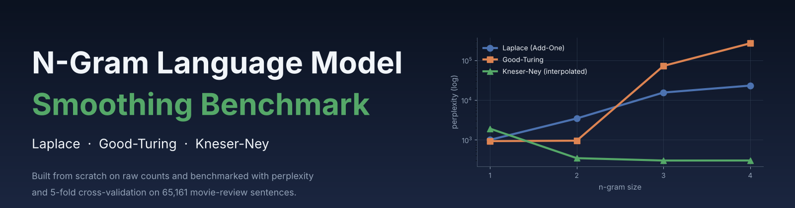
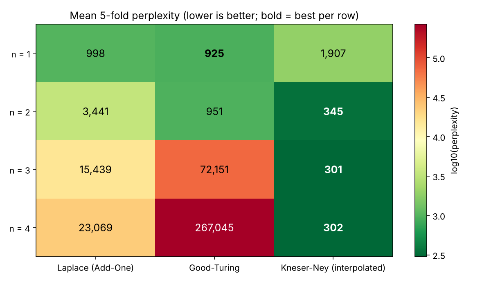
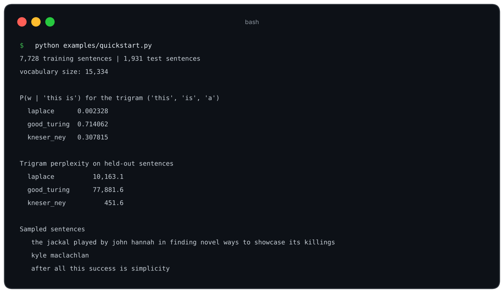
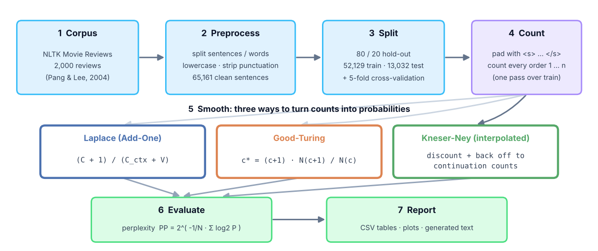
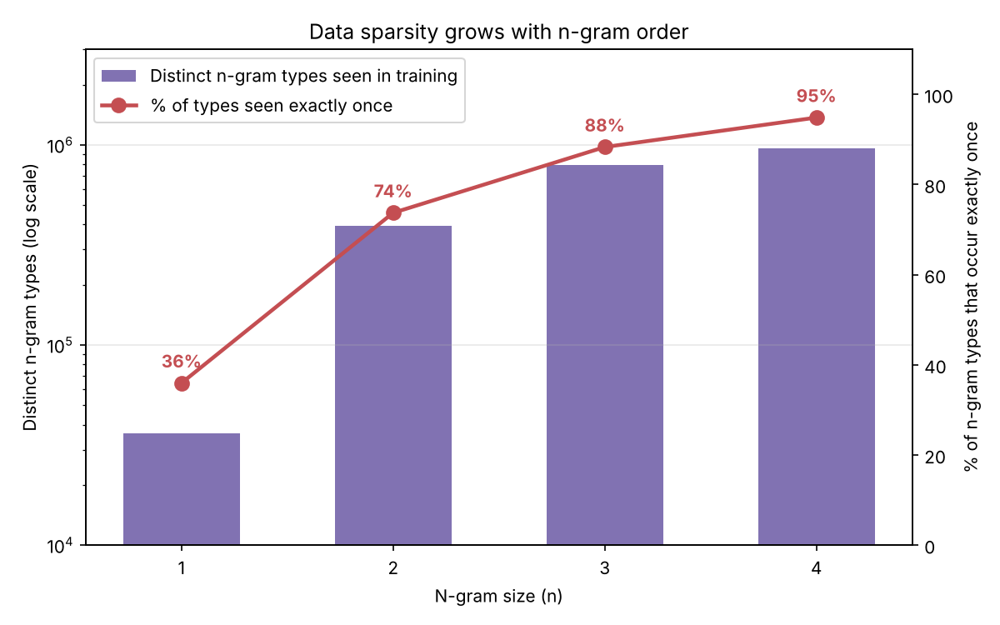
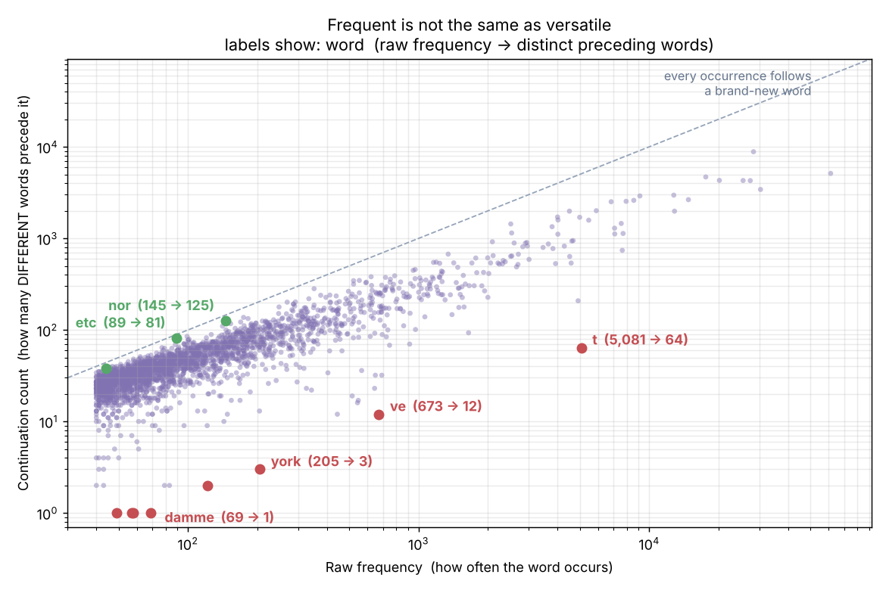
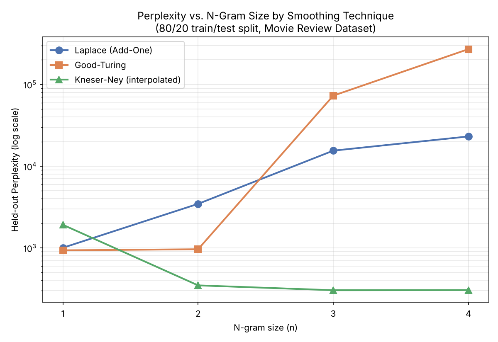
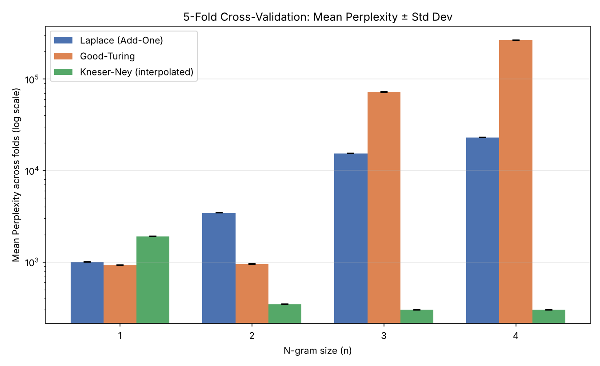
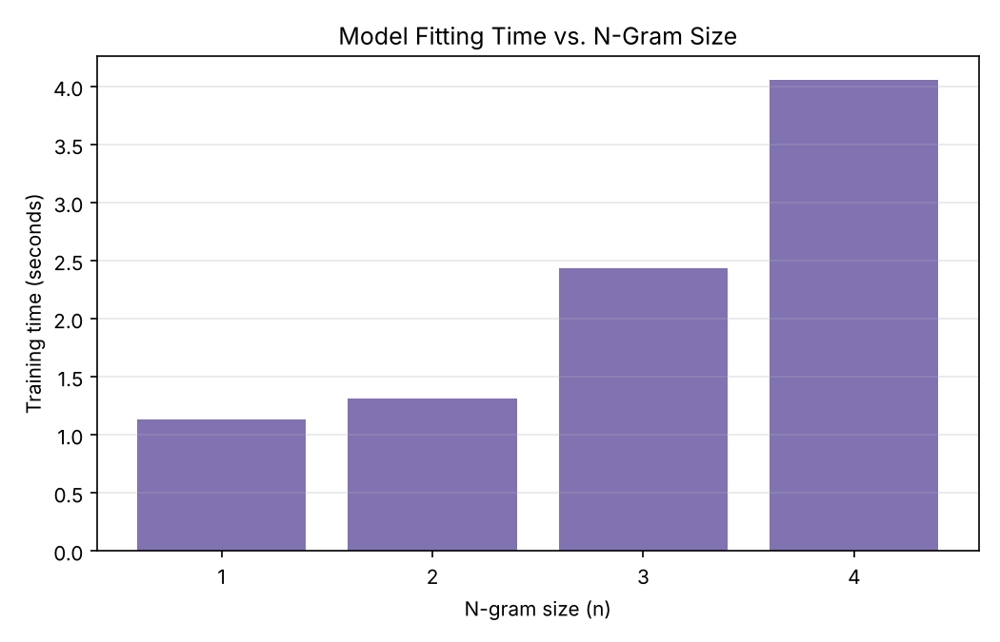
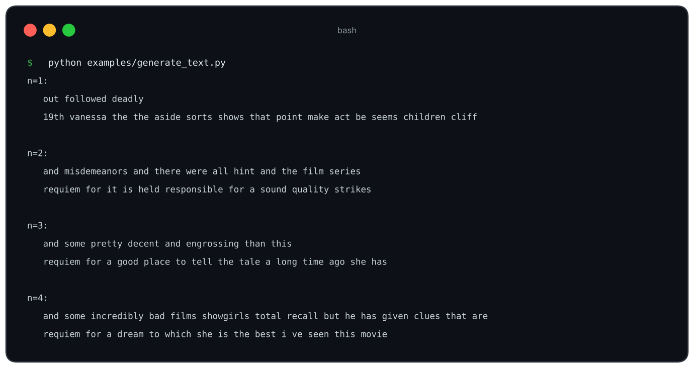

<p align="center">
  
</p>

<h1 align="center">N-Gram Language Model Smoothing Benchmark</h1>

<p align="center">
  <b>Laplace · Good-Turing · Kneser-Ney</b><br>
  N-gram language models (n = 1 to 4) built from raw counts, with three smoothing techniques,<br>
  benchmarked by perplexity and 5-fold cross-validation on 65,161 movie-review sentences.
</p>

<p align="center">
  <a href="https://github.com/Stephen-Austine/ngram-language-model-smoothing-benchmark/actions/workflows/tests.yml"></a>
  
  
  
  
  
</p>

<p align="center">
  <a href="#key-findings">Key findings</a> ·
  <a href="#quick-start">Quick start</a> ·
  <a href="#how-it-works">How it works</a> ·
  <a href="#results">Results</a> ·
  <a href="#analysis">Analysis</a> ·
  <a href="#limitations-and-honest-caveats">Limitations</a> ·
  <a href="#api-reference">API</a>
</p>

---

## Table of contents

1. [Overview](#overview)
2. [Key findings](#key-findings)
3. [Features](#features)
4. [Project structure](#project-structure)
5. [Quick start](#quick-start)
6. [How it works](#how-it-works)
   - [The pipeline](#the-pipeline)
   - [Data preparation](#1-data-preparation)
   - [Counting n-grams](#2-counting-n-grams)
   - [Smoothing techniques](#3-smoothing-techniques)
   - [Evaluation: perplexity](#4-evaluation-perplexity)
   - [Hold-out and cross-validation](#5-hold-out-and-cross-validation)
7. [Results](#results)
8. [Analysis](#analysis)
9. [Text generation](#text-generation)
10. [Design decisions](#design-decisions)
11. [Limitations and honest caveats](#limitations-and-honest-caveats)
12. [Reproducibility](#reproducibility)
13. [API reference](#api-reference)
14. [Testing](#testing)
15. [Extending the project](#extending-the-project)
16. [FAQ](#faq)
17. [Ideas for future work](#ideas-for-future-work)
18. [References](#references)
19. [License, author and citation](#license-author-and-citation)

---

## Overview

A language model answers one question: *how likely is this word, given the words before it?* The simplest
way to build one is to **count**. Count how often every sequence of `n` words appears in a corpus, and turn
those counts into conditional probabilities. That is an **n-gram model**.

The catch is **sparsity**. Most word sequences that a real sentence can contain were never seen in training, so
a model built on raw counts assigns them probability zero and breaks. **Smoothing** is the family of techniques
that fixes this by taking a little probability mass from what was seen and giving it to what was not.

This project implements all of it by hand, using only the Python standard library for the model itself:

- an **n-gram language model** for any order `n` (this study uses `n = 1, 2, 3, 4`),
- **three smoothing techniques**: Laplace (Add-One), Good-Turing and interpolated Kneser-Ney,
- **perplexity** evaluation, a held-out 80/20 split and **5-fold cross-validation**,
- a **text generator** to *see* what each order of model learns,
- diagnostics that go beyond a single results table (sparsity, unseen-event rates, probability-floor usage).

It answers a practical question that every NLP student eventually meets:

> **How do n-gram size and smoothing technique affect a language model, and why?**

The short answer is that they are **not independent choices**. A bigger `n` only helps if the smoothing method
is built to cope with the sparsity that a bigger `n` creates. The experiments below show exactly how dramatic the
difference is: from a perplexity of about **300** (Kneser-Ney) to over **267,000** (naive Good-Turing) on the same
data with the same `n`.

> [!NOTE]
> This project began as a university NLP lab (DSA4020A, *Lab Assignment 1: Exploring Language Modeling with
> N-Gram Sizes and Smoothing Techniques*). It has since been restructured into an installable package with tests,
> a command-line experiment runner, extra diagnostics and a long-form write-up. The original lab report is kept in
> [`docs/`](docs/ngram_smoothing_lab_report.docx).

---

## Key findings

All numbers are **mean perplexity over 5-fold cross-validation (lower is better)** on 65,161 sentences from the
NLTK Movie Review corpus.

<p align="center">
  
</p>

| Question | Answer |
|---|---|
| **Best configuration?** | **Kneser-Ney with n = 3** (perplexity **300.8 ± 2.3**). n = 4 is statistically tied (301.5 ± 2.6). |
| **What happens to Laplace as n grows?** | It degrades steadily: **998 → 23,069** from n = 1 to n = 4 (about 23× worse). |
| **What happens to Good-Turing as n grows?** | It collapses: **925 → 267,045** (about 289× worse). The best unigram result in the study. The worst 4-gram result. |
| **What happens to Kneser-Ney as n grows?** | It improves, then plateaus: **1,907 → 345 → 301 → 302**. |
| **How sparse is the data?** | **95%** of distinct 4-gram types occur exactly once, and **81%** of held-out 4-grams were never seen in training. |
| **Are the results stable?** | Yes. Fold-to-fold standard deviation for Kneser-Ney is only **2 to 9 perplexity points** at every n. |
| **What does more context buy you?** | With Kneser-Ney, roughly **3× lower perplexity** than the best unigram model, plus visibly more coherent generated text. |

**The one-sentence takeaway:** *increasing n alone does not improve a language model; pairing a larger n with a
smoothing method designed for sparse data (Kneser-Ney) does.*

---

## Features

- **Everything implemented from scratch.** Counting, the three smoothing formulas, perplexity and text sampling are plain
  Python (`collections`, `math`). NLTK is used only to load the corpus.
- **One model, three smoothers.** A single `NGramLanguageModel` is fitted once; you choose the smoothing method per
  query (`"laplace"`, `"good_turing"`, `"kneser_ney"`).
- **Proper evaluation.** Corpus-level perplexity in log space (no underflow), a fixed-seed 80/20 hold-out split and
  5-fold cross-validation with mean and standard deviation per configuration.
- **Reproducible to the last digit.** Fixed seeds everywhere. Re-running the full experiment reproduces the published
  perplexities with a difference of exactly `0.0`.
- **A real command-line tool.** `python -m ngram_smoothing.experiments` runs the study end to end and writes tables and plots.
- **Installable package with tests.** `pip install -e .`, 29 unit tests that run in well under a second and need no
  corpus download.
- **Honest about its limits.** A dedicated [limitations section](#limitations-and-honest-caveats) documents every
  known simplification, backed by a [diagnostics script](scripts/diagnostics.py) rather than hand-waving.
- **Zero setup for data.** The corpus downloads automatically on first use. No Kaggle account or API key.

---

## Project structure

```text
ngram-language-model-smoothing-benchmark/
├── ngram_smoothing/               # The installable package
│   ├── __init__.py                #   Public API: NGramLanguageModel, data helpers
│   ├── data.py                    #   Corpus loading, cleaning, train/test and k-fold splits
│   ├── model.py                   #   NGramLanguageModel + Laplace / Good-Turing / Kneser-Ney
│   └── experiments.py             #   Experiment grid, cross-validation, plots, CLI
│
├── examples/
│   ├── quickstart.py              # Fit a model, compare smoothers, sample text (a few seconds)
│   └── generate_text.py           # Sample sentences for n = 1..4 on the full corpus
│
├── notebooks/
│   └── ngram_smoothing_analysis.ipynb   # Self-contained walkthrough with outputs and plots
│
├── scripts/
│   ├── diagnostics.py             # Reproduces every secondary number quoted in this README
│   └── make_readme_art.py         # Regenerates the banner, diagram and terminal cards
│
├── tests/
│   └── test_model.py              # 29 fast unit tests on a toy corpus
│
├── results/                       # Committed outputs of the full run
│   ├── results_holdout.csv        #   80/20 perplexity + fit time for all 12 configurations
│   ├── results_cv.csv             #   5-fold mean and std for all 12 configurations
│   ├── ngram_statistics.csv       #   Distinct types, singleton share and event-space size per order
│   └── diagnostics.txt            #   Output of scripts/diagnostics.py
│
├── assets/                        # Figures used in this README
├── docs/
│   └── ngram_smoothing_lab_report.docx  # The original formal lab report
│
├── .github/workflows/tests.yml    # CI: runs the test suite on every push
├── pyproject.toml                 # Packaging and the `ngram-experiments` command
├── requirements.txt               # Runtime dependencies
├── requirements-dev.txt           # + pytest and jupyter
├── LICENSE                        # MIT
└── README.md
```

---

## Quick start

### 1. Install

```bash
git clone https://github.com/Stephen-Austine/ngram-language-model-smoothing-benchmark.git
cd ngram-language-model-smoothing-benchmark

python -m venv .venv
source .venv/bin/activate          # Windows: .venv\Scripts\activate

pip install -e .                   # installs the package and its dependencies
```

Requirements: Python 3.10 or newer, plus `nltk`, `pandas`, `matplotlib` and `numpy`. The NLTK corpus
(`movie_reviews`) and tokenizer data download automatically the first time they are needed.

> [!TIP]
> Want the notebook and the test runner too? Use `pip install -e ".[dev]"`.

### 2. Try it in a few seconds

```bash
python examples/quickstart.py
```

<p align="center">
  
</p>

That output already tells the story. For the same trigram, the three smoothers disagree wildly
(`0.0023` vs `0.714` vs `0.308`), and on held-out text they produce perplexities of about 10,163, 77,882 and 452.

### 3. Reproduce the full study

```bash
python -m ngram_smoothing.experiments
```

This runs the whole 4 × 3 grid with hold-out evaluation and 5-fold cross-validation, then writes CSV tables to
`results/` and figures to `assets/`. It takes about **two minutes on a single CPU core**.

| Option | Meaning |
|---|---|
| `--reviews 200` | Use a random sample of 200 reviews instead of all 2,000 (about 15 seconds) |
| `--folds 3` | Use 3-fold instead of 5-fold cross-validation |
| `--skip-cv` | Skip cross-validation entirely |
| `--results-dir DIR` | Where CSV tables are written (default `results/`) |
| `--figures-dir DIR` | Where PNG figures are written (default `assets/`) |

The same entry point is also installed as a command: `ngram-experiments --reviews 200`.

### 4. Use it as a library

```python
from ngram_smoothing import NGramLanguageModel, load_and_preprocess_sentences, train_test_split

sentences = load_and_preprocess_sentences()            # 65,161 cleaned sentences
train, test = train_test_split(sentences, test_ratio=0.2)

lm = NGramLanguageModel(3).fit(train)                  # trigram model

# Conditional probability P(w3 | w1, w2) under each smoother
lm.prob(("this", "film", "is"), "kneser_ney")
lm.prob(("this", "film", "is"), "laplace")

# Held-out perplexity (lower is better)
lm.perplexity(test, "kneser_ney")                      # ≈ 303.6

# Sample text from the raw trigram distribution
lm.generate(max_tokens=15, seed=1)
```

You are not limited to movie reviews. Anything that is a list of token lists works:

```python
from ngram_smoothing import NGramLanguageModel

corpus = [["the", "cat", "sat"], ["the", "dog", "sat"], ["a", "cat", "ran"]]
lm = NGramLanguageModel(2).fit(corpus)
lm.perplexity([["the", "cat", "sat"]], "kneser_ney")
```

### 5. Explore the notebook

```bash
pip install -e ".[dev]"
jupyter notebook notebooks/ngram_smoothing_analysis.ipynb
```

The notebook is fully self-contained (it defines the model inline), already contains its outputs and plots, and renders
directly on GitHub.

---

## How it works

### The pipeline

<p align="center">
  
</p>

Every configuration in the study follows the same seven steps. The only things that change between the 12 runs are
the order `n` and the smoothing method applied to the counts.

### 1. Data preparation

**Corpus.** The 2,000-review *Movie Review Polarity* corpus (Pang & Lee, 2004), loaded through
`nltk.corpus.movie_reviews`. The "Movie Review Dataset" that circulates on Kaggle is a copy of this same corpus.
The sentiment labels are ignored here; only the text matters for language modeling.

**Cleaning** (`ngram_smoothing/data.py`):

| Step | Example |
|---|---|
| Sentence and word tokenization (already provided by the corpus reader) | `['plot', ':', 'two', 'teen', 'couples', ...]` |
| Lowercase everything | `Plot` → `plot` |
| Strip punctuation and special characters | `':'` → removed |
| Drop empty tokens, then drop sentences shorter than 3 tokens | punctuation-only "sentences" disappear |

Before and after, taken from the first review:

```text
raw:     ['plot', ':', 'two', 'teen', 'couples', 'go', 'to', 'a', 'church', 'party', ',', 'drink', 'and', 'then', 'drive', '.']
cleaned: ['plot', 'two', 'teen', 'couples', 'go', 'to', 'a', 'church', 'party', 'drink', 'and', 'then', 'drive']
```

**Size.** 65,161 sentences and 1,333,319 tokens after cleaning. A fixed-seed shuffle produces an 80/20 split of
**52,129 training** and **13,032 test** sentences. The training vocabulary has **36,334** word types.

### 2. Counting n-grams

Every sentence is **padded** with `n − 1` start markers `<s>` and one end marker `</s>`, so the model can learn
what begins and ends a sentence. For a trigram model, `"great movie"` becomes:

```text
<s> <s> great movie </s>
```

and yields the trigrams `(<s>, <s>, great)`, `(<s>, great, movie)` and `(great, movie, </s>)`.

The model counts **every order from 1 up to n**, not only order `n`. Good-Turing needs the order `n − 1` counts to
form a conditional probability, and Kneser-Ney recursively backs off through every lower order down to unigrams.
(Even a unigram model keeps bigram counts, because Kneser-Ney's continuation counts are defined in terms of them.)

The raw maximum-likelihood estimate that all three smoothers start from is:

$$
P_{\text{MLE}}(w_i \mid w_{i-n+1}^{i-1}) = \frac{C(w_{i-n+1}^{i})}{C(w_{i-n+1}^{i-1})}
$$

Any n-gram absent from training has `C = 0` and therefore probability **zero**, which makes the probability of
any test sentence containing one equal to zero and its perplexity infinite. That is the sparsity problem, and it is
severe:

<p align="center">
  
</p>

| n | Distinct types seen in training | Types seen exactly once | Possible types, (V+1)^n |
|---|---|---|---|
| 1 | 36,335 | 36.0% | 3.63e+04 |
| 2 | 393,845 | 73.7% | 1.32e+09 |
| 3 | 790,859 | 88.3% | 4.80e+13 |
| 4 | 956,799 | 94.9% | 1.74e+18 |

By `n = 4`, **95% of everything the model has seen, it has seen exactly once**, and **81% of the 4-grams in held-out
text never appeared in training at all**. Each smoother is a different answer to the question of how to assign
probability to those unseen events.

### 3. Smoothing techniques

All three methods build on the same counts. Throughout, `h` is the history (the previous `n − 1` words), `V` is the
vocabulary size and `C(·)` is a raw count.

#### Laplace (Add-One)

Pretend every possible n-gram was seen once more than it really was.

$$
P_{\text{Laplace}}(w \mid h) = \frac{C(h, w) + 1}{C(h) + V}
$$

- **Strength:** trivially simple, never produces a zero, never breaks down catastrophically.
- **Weakness:** it adds `V` (36,334) to *every* denominator. For a high-order context that was seen only a few times, the
  `+V` swamps the real evidence and almost all probability mass is shipped to unseen events. The more sparse the data,
  the worse it gets.

#### Good-Turing

Re-estimate each observed count using how many n-grams were seen *one more time*. If `N_c` is the number of distinct
n-gram types that occur exactly `c` times:

$$
c^{*} = (c + 1)\,\frac{N_{c+1}}{N_c}
\qquad\qquad
P_0 = \frac{N_1}{N}
$$

The total mass `P_0 = N_1 / N` (the share of observations that were singletons) is reserved for unseen n-grams and
spread **uniformly** over all of them. The conditional probability is then the ratio of two Good-Turing joint
estimates, order `n` over order `n − 1`:

$$
P_{\text{GT}}(w \mid h) = \min\!\left(1,\; \frac{P_{\text{GT}}(h, w)}{P_{\text{GT}}(h)}\right)
$$

When `N_{c+1}` is zero (the sparse high-count tail), the raw count `c` is used instead.

> [!IMPORTANT]
> This is a deliberately **naive** Good-Turing, as it is usually first presented in a course. It does not smooth the
> `N_c` curve (as *Simple Good-Turing* does), it does not renormalise, and it spreads the unseen mass uniformly over
> the entire `V^n` event space. Those simplifications are exactly why it blows up at high `n`. See
> [Analysis](#why-good-turing-fails-at-high-n). It should be read as "naive Good-Turing", **not** as a verdict on the
> technique in general.

#### Kneser-Ney (interpolated)

Discount every observed count by a fixed amount `D`, and give the freed-up mass to a **lower-order** model, weighted by
how many distinct words have followed this history. The lower-order model is not the plain frequency distribution but the
**continuation** distribution:

$$
P_{\text{KN}}(w \mid h) = \frac{\max\big(C(h, w) - D,\, 0\big)}{C(h)} \;+\; \underbrace{\frac{D \cdot N_{1+}(h\,\bullet)}{C(h)}}_{\lambda(h)} \; P_{\text{KN}}(w \mid h')
$$

where `h'` is the history with its oldest word dropped and `N_{1+}(h •)` is the number of distinct words seen after `h`.
The recursion bottoms out at the unigram **continuation probability**:

$$
P_{\text{cont}}(w) = \frac{N_{1+}(\bullet\, w) + 1}{N_{1+}(\bullet\,\bullet) + V}
$$

where `N_{1+}(• w)` is the number of *distinct* words that ever precede `w`. The discount is estimated from the data
for each order with the Chen & Goodman (1999) approximation, clipped to a sane range:

$$
D = \frac{n_1}{n_1 + 2\,n_2}, \qquad D \in [0.1,\ 0.9]
$$

If a history was never seen at all, the model backs off completely to the lower order.

The key idea is the continuation count. The word *Francisco* may be frequent, but it almost only ever follows *San*. As a
fallback for an unseen context, it should be a poor guess. A word that follows *many different* words is a better bet to
follow a *new* one. The same effect is visible in this corpus:

<p align="center">
  
</p>

Words below the diagonal are frequent without being versatile. In the real training data, **"york"** appears 205 times
but only ever after **3** distinct words, and **"damme"** appears 69 times but always after the same single word.
Kneser-Ney's backoff distribution correctly treats them as unlikely to appear in a brand-new context, whereas a
frequency-based backoff would not. (The bottom-right outlier, **"t"**, is an artifact of stripping apostrophes from
contractions: `don't` becomes `don` + `t`. See [limitations](#limitations-and-honest-caveats).)

### 4. Evaluation: perplexity

**Perplexity** measures how surprised the model is by text it has never seen. It is the inverse probability of the test
set, normalised by the number of predictions `N`. Lower is better; it can be read as the model's effective
branching factor.

$$
\mathrm{PP}(W) = 2^{\,-\frac{1}{N}\sum_{i=1}^{N} \log_2 P(w_i \mid w_{i-n+1}^{i-1})}
$$

It is computed in log space over **every n-gram of every test sentence** (a corpus-level figure, not an average of
per-sentence perplexities), which avoids numerical underflow. Each probability is floored at `1e-12` before taking the
logarithm. The [limitations](#limitations-and-honest-caveats) section reports how often that floor actually fires.

### 5. Hold-out and cross-validation

| Protocol | Details |
|---|---|
| **Hold-out** | One fixed-seed 80/20 split: 52,129 training sentences, 13,032 test sentences. |
| **5-fold CV** | The shuffled sentences are cut into 5 folds. Each fold is the test set once. Mean and (population) standard deviation of perplexity are reported per configuration. |
| **Grid** | n ∈ {1, 2, 3, 4} × {Laplace, Good-Turing, Kneser-Ney} = **12 configurations**, each evaluated both ways. |

Cross-validation exists to answer one question: *is this ranking an accident of one particular split?* (It is not. See below.)

---

## Results

### Hold-out perplexity (80/20 split)

| N-gram size | Laplace | Good-Turing | Kneser-Ney |
|---|---|---|---|
| n = 1 | 1,004.9 | **934.7** | 1,916.4 |
| n = 2 | 3,461.4 | 963.2 | **348.0** |
| n = 3 | 15,496.1 | 72,996.3 | **303.6** |
| n = 4 | 23,130.3 | 270,723.5 | **304.8** |

Bold marks the best smoother for each `n`.

<p align="center">
  
</p>

### 5-fold cross-validation (mean ± standard deviation)

| N-gram size | Laplace | Good-Turing | Kneser-Ney |
|---|---|---|---|
| n = 1 | 997.8 ± 7.6 | **925.0 ± 8.5** | 1,906.9 ± 9.3 |
| n = 2 | 3,440.9 ± 19.9 | 950.7 ± 8.5 | **345.5 ± 2.0** |
| n = 3 | 15,438.7 ± 45.7 | 72,151.1 ± 1,008.5 | **300.8 ± 2.3** |
| n = 4 | 23,069.3 ± 49.0 | 267,045.0 ± 2,417.0 | **301.5 ± 2.6** |

<p align="center">
  
</p>

The standard deviations are tiny relative to the gaps between methods, so the ranking is not an artifact of a lucky split.

### Training cost

| n | Distinct n-gram types stored | Types seen exactly once | Fit time (this machine) |
|---|---|---|---|
| 1 | 36,335 | 36.0% | 1.13 s |
| 2 | 393,845 | 73.7% | 1.32 s |
| 3 | 790,859 | 88.3% | 2.44 s |
| 4 | 956,799 | 94.9% | 4.06 s |

<p align="center">
  
</p>

Fit time and the number of stored n-gram types both grow with `n`. Timings are machine-dependent (they come from a
single run on one CPU core and are included to show the trend, not as a benchmark).

<details>
<summary><b>Raw files</b></summary>

| File | Contents |
|---|---|
| [`results/results_holdout.csv`](results/results_holdout.csv) | `n, method, perplexity, fit_time_s` for all 12 configurations |
| [`results/results_cv.csv`](results/results_cv.csv) | `n, method, mean_perplexity, std_perplexity` for all 12 configurations |
| [`results/ngram_statistics.csv`](results/ngram_statistics.csv) | Distinct types, singleton share and event-space size per order |
| [`results/diagnostics.txt`](results/diagnostics.txt) | Unseen-event rates, probability-floor usage, OOV rate, and more |

</details>

---

## Analysis

### How n-gram size affects performance

It depends entirely on the smoother.

- **Laplace and Good-Turing get worse as `n` grows.** This is the classic data-sparsity effect. With a 36,334-word
  vocabulary, the number of possible 4-grams is on the order of `10^18`, while the training set contains fewer than a million
  distinct ones. The extra context is real information, but neither method can use it, because most histories have been
  seen only once or never.
- **Kneser-Ney gets better, then plateaus.** Going from unigram to bigram cuts perplexity about **5.5×**
  (1,907 → 345). A third word of context helps again (→ 301), and a fourth adds nothing measurable (→ 302), which is
  smaller than the fold-to-fold standard deviation. On a corpus of this size there is simply not enough data to
  estimate useful 4-gram statistics, and Kneser-Ney's interpolation gracefully falls back on the trigram evidence.

### How the smoothing technique affects performance

For every `n ≥ 2`, **Kneser-Ney is the clear winner**, and by a wide margin at `n ≥ 3` (about 51× to 77× lower than Laplace and 240× to 886× lower than Good-Turing).
At `n = 1` the picture is different, and worth understanding rather than glossing over:

| At n = 1 | Perplexity | Likely reason |
|---|---|---|
| Good-Turing | **925** | Likely because counts are large and dense, so the frequency-of-frequency statistics are reliable. |
| Laplace | 998 | Likely because with only 36,334 outcomes, adding one barely distorts a well-estimated distribution. |
| Kneser-Ney | 1,907 | A continuation distribution is built to be a **backoff** distribution, not a stand-alone unigram model. |

The last row is not a bug. Measured on the training split, the ten most frequent tokens (`the`, `</s>`, `a`, `and`, `of`,
`to`, `is`, `in`, `s`, `it`) hold **24.8%** of the probability mass under raw frequency (24.1% under Laplace) but only
**11.7%** under the Kneser-Ney continuation distribution. That is deliberate: it is shifting weight toward
words that appear in many contexts. It is the right thing to do for an *unseen* context and the wrong thing to do when
the unigram distribution is the whole model. Kneser-Ney exists to be used with `n ≥ 2`, where it dominates.

### Why Good-Turing fails at high n

Good-Turing is among the most important ideas in smoothing, so its collapse here deserves an explanation. It comes from
the specific, naive implementation described above:

1. Unseen mass `N_1 / N` is spread **uniformly** across the whole event space of `V^n` possible n-grams. For `n = 3`
   that is about `4.8 × 10^13` events, so each unseen trigram gets a vanishingly small slice.
2. The conditional probability is a **ratio of two joint estimates**. When the history was seen but the full n-gram was
   not, the numerator is that vanishingly small slice, and the result is an extremely small probability.
3. Because 63% of held-out trigrams and 81% of 4-grams are unseen, such events are not rare edge cases, they are the
   majority of what the model is asked to score.

The diagnostics script confirms the mechanism. At `n = 4`, **14.7%** of Good-Turing's predictions fall below the `1e-12`
floor. (At `n = 3` it is 0.2%, and for Laplace and Kneser-Ney it is 0.0% at every order.) That floor actually *flatters*
Good-Turing: with it removed, the 4-gram perplexity would be about **399,500** instead of **270,700**. The ranking is
unaffected either way.

A production Good-Turing (Simple Good-Turing smoothing of the `N_c` curve, combined with Katz backoff) behaves far better.
This is a statement about the *naive* variant, not the technique.

### Trade-offs between complexity and accuracy

- **Memory and time grow with `n`.** The model stores 36 k unigram types, 394 k bigram types, 791 k trigram types and
  957 k 4-gram types. Fitting the 4-gram model takes roughly 3.6× longer than the unigram model on the same machine.
- **Complexity only pays off with the right smoother.** Under Laplace, a 4-gram model is about **23× worse** than a
  unigram model while being far more expensive to build. Under Kneser-Ney, the extra context buys a roughly **3×**
  improvement over the best unigram model.
- **Diminishing returns are real.** Going from `n = 3` to `n = 4` takes about 1.7× the training time and improves
  nothing measurable. On this corpus, `n = 3` with Kneser-Ney is the sweet spot.

### Robustness

Fold-to-fold standard deviation is small everywhere that matters (2.0 to 9.3 points for Kneser-Ney at every order),
which confirms the conclusions are not an accident of one split. The one exception is Good-Turing at `n = 3` and
`n = 4`, with standard deviations of about 1,008 and 2,417. That instability is itself a symptom of the problem described above.

---

## Text generation

Perplexity is a number. Text is evidence you can read. Each model can also be used to *sample* sentences from its raw
(unsmoothed) next-word distribution:

```bash
python examples/generate_text.py
```

<p align="center">
  
</p>

What to notice:

- **n = 1** is a word salad. Every word is drawn independently of its neighbours.
- **n = 2** produces short, locally plausible fragments (*"and the film series"*).
- **n = 3** and **n = 4** contain long, grammatical stretches (*"requiem for a good place to tell the tale"*,
  *"to which she is the best i ve seen this movie"*).
- At `n = 4`, the model starts **copying the training data**. With 95% of 4-grams seen exactly once, a 4-gram context
  likely has only one possible continuation, so sampling is probably closer to retrieval than to generation. Perplexity and
  fluency measure different things, and this is the reason both are worth looking at.

> [!NOTE]
> Sampling uses the raw counts, not the smoothed probabilities, so it is a qualitative illustration only and is not part of
> the perplexity evaluation. Sampled text depends on the random seed.

---

## Design decisions

| Decision | Reasoning |
|---|---|
| **Single class, three smoothers** | Counts are shared, so the model is fitted once per `n` and evaluated three ways. It keeps the comparison fair: all three methods see exactly the same counts. |
| **Count every order `1..n`** | Good-Turing needs the order `n − 1` estimate for its ratio, and Kneser-Ney recurses through all lower orders. |
| **Keep bigram counts even when `n = 1`** | Kneser-Ney's continuation counts (how many distinct words precede `w`) are defined from bigrams. Without them there is no unigram KN model to speak of. |
| **`n − 1` start markers, one end marker** | The standard formulation. A trigram model sees `<s> <s> w1 …`, so the first word is conditioned on a proper sentence-start context. |
| **Discount `D = n₁ / (n₁ + 2 n₂)`** | The Chen & Goodman (1999) closed-form estimate; no tuning set required. A fixed value can be forced with `kn_discount=`. |
| **Log-space perplexity** | Multiplying thousands of small probabilities underflows. Summing `log₂` probabilities does not. |
| **Probability floor `1e-12`** | A safety net against `log(0)`. It is rarely active (see [diagnostics](results/diagnostics.txt)). |
| **Seeds everywhere** | Sampling reviews, shuffling for the split, k-fold assignment and text generation are all seeded, so results are reproducible. |
| **No ML libraries in the model** | The point of the project is to understand the mechanics. The model uses only `collections.Counter`, `defaultdict` and `math`. |

---

## Limitations and honest caveats

Knowing where a result stops being trustworthy is part of the result. Everything below is a deliberate simplification
or a known property of the current implementation, and none of it changes the ranking of the methods.

**Evaluation protocol**

- **The split is by sentence, not by review.** Sentences from the same review can land on both sides of the split, which
  likely makes every perplexity somewhat optimistic. A review-level split would be stricter. (The comparison between
  methods is unaffected, since all methods share the same split.)
- **No `<UNK>` handling.** Words unseen in training are not mapped to a special token; the smoothers just treat them as rare
  events. **1.24%** of held-out tokens (3,305 of 266,410) are out of vocabulary. Absolute perplexities are therefore
  **not comparable with figures from the literature**, which typically use a closed vocabulary. Only comparisons *within*
  this study are meaningful.
- **The unigram model scores slightly different events.** A unigram model also predicts the `<s>` marker (13,032 extra
  events, 4.5% of the total), while higher orders condition on it instead. That makes `n = 1` numbers marginally
  incomparable with `n ≥ 2`. It does not affect any conclusion about `n ≥ 2`.

**Smoothing implementations**

- **Naive Good-Turing.** No smoothing of the `N_c` curve, no renormalisation, uniform spread of unseen mass over `V^n`, and
  the conditional is clipped to 1. This is the simplest textbook form, and it is responsible for the poor
  results at `n ≥ 3`.
- **Single-discount Kneser-Ney.** One discount `D` per order (the original formulation), not the three-discount *modified*
  Kneser-Ney of Chen & Goodman, which usually does slightly better.
- **A tiny normalisation quirk in Kneser-Ney for `n ≥ 3`.** The `<s>` marker is counted as a continuation but is not part of
  `V`, so the continuation base distribution is off by about `1 / (bigram types + V)`, which is **2.3 × 10⁻⁶** on the full
  corpus. It has no measurable effect on perplexity, but it is why the trigram unit test uses a looser tolerance than
  the bigram test. The model was deliberately left unchanged so the published numbers stay identical.
- **Probability floor.** Probabilities are floored at `1e-12`. It affects only Good-Turing at `n = 4` (14.7% of events) and
  there it *lowers* the reported perplexity. See [Analysis](#why-good-turing-fails-at-high-n).

**Preprocessing**

- **Stripping apostrophes splits contractions into fragments.** `don't` becomes `don` + `t`, and `I've` becomes `i` + `ve`.
  That is why tokens like `t` and `ve` are among the most frequent in the corpus, and why generated text contains
  *"i ve seen"*. It is a simple, defensible choice for a coursework-scale study, but a contraction-aware tokenizer
  would be cleaner.
- **Lowercasing discards capitalisation** (*Apple* vs *apple*), as is standard for classic n-gram language models.

**Scale and performance**

- **Pure-Python dictionaries of tuples.** Memory and speed are fine for ~1M tokens and will not scale to billions. Real-world
  systems use tries, hashed or quantised tables and pruning (KenLM, for example).
- **`generate()` scans the n-gram table for every sampled word**, which is perfectly fine for illustration and would be slow
  on a large model.
- **Timings come from one run on one machine** and are provided to show the trend.

---

## Reproducibility

- **Seeds:** `RANDOM_SEED = 42` controls review sampling, the train/test shuffle and k-fold assignment. Text generation is seeded per call.
- **Verified:** after restructuring the original scripts into this package, the full experiment was re-run from scratch.
  Every perplexity and every cross-validation standard deviation matched the original published values with a maximum
  absolute difference of `0.0`. Only the (hardware-dependent) fit times differ.
- **Tested with:** Python 3.12, `nltk 3.10`, `pandas 3.0`, `matplotlib 3.11`, `numpy 2.5`.
- **Data:** fetched automatically from NLTK on first use, and so identical for everyone.
- **Regenerate everything yourself:**

```bash
python -m ngram_smoothing.experiments        # tables + result figures
python scripts/diagnostics.py | tee results/diagnostics.txt
python scripts/make_readme_art.py            # banner, pipeline diagram, terminal cards
```

---

## API reference

### `NGramLanguageModel(n, kn_discount=None)`

| Member | Description |
|---|---|
| `fit(sentences)` | Count n-grams of every order `1..n` and precompute Good-Turing and Kneser-Ney statistics. `sentences` is a list of token lists. Returns `self`. |
| `prob(ngram, method)` | `P(w_n \| w_1..w_{n-1})` for an n-gram tuple. `method` is `"laplace"`, `"good_turing"` or `"kneser_ney"`. |
| `laplace_prob(ngram)` | Add-One probability. |
| `good_turing_prob(ngram)` | Good-Turing probability (ratio of joint estimates). |
| `kneser_ney_prob(ngram)` | Interpolated Kneser-Ney probability. |
| `sentence_log_prob(sentence, method)` | `(sum of log2 probabilities, number of events)` for one padded sentence. |
| `perplexity(sentences, method)` | Corpus-level perplexity over a list of sentences. |
| `generate(max_tokens=20, seed=None)` | Sample a sentence from the raw order-`n` distribution. |
| `counts` | `{k: Counter}` of raw k-gram counts for `k = 1..max(n, 2)`. |
| `vocab`, `total_unigrams` | Vocabulary set and total unigram count. |

`kn_discount` forces a single discount `D` for every order. By default `D` is estimated per order from the data.

### Data helpers (`ngram_smoothing.data`)

| Function | Description |
|---|---|
| `load_and_preprocess_sentences(n_reviews=None, min_len=3)` | Load, tokenize, lowercase and de-punctuate the corpus. `n_reviews` takes a reproducible sample. |
| `train_test_split(sentences, test_ratio=0.2, seed=42)` | Shuffle and split. Returns `(train, test)`. |
| `k_fold_split(sentences, k=5, seed=42)` | Generator of `(train, test)` pairs. |
| `clean_token(tok)` | Lowercase and strip punctuation from a single token. |

### Experiment helpers (`ngram_smoothing.experiments`)

`run_holdout_evaluation`, `run_cross_validation`, `ngram_statistics`, and the plotting functions
`plot_holdout_results`, `plot_cv_results`, `plot_fit_time`, `plot_heatmap`, `plot_sparsity`.

---

## Testing

```bash
pip install -e ".[dev]"
pytest
```

```text
29 passed in 0.03s
```

The suite uses a 12-sentence toy corpus (no download, no network) and checks, among other things, that:

- Laplace and Kneser-Ney bigram distributions **sum to exactly 1** over the vocabulary,
- every smoother gives **valid, non-zero** probabilities to unseen and out-of-vocabulary n-grams,
- perplexity is **lower on seen text than on gibberish**, and is `inf` for an empty test set,
- padding, n-gram extraction, splitting and k-fold partitioning behave as documented,
- generation is **reproducible** with a seed,
- the documented limitations hold (Good-Turing reserves no unseen mass when a corpus has no singletons).

The test suite also runs on every push through GitHub Actions.

---

## Extending the project

**Add a new smoothing method** (for example Jelinek-Mercer interpolation or Witten-Bell):

1. Add a `_fit_xxx()` step to `fit()` in [`model.py`](ngram_smoothing/model.py) if it needs precomputed statistics.
2. Implement `xxx_prob(self, ngram)`.
3. Register it in the `prob()` dispatcher.
4. Add its name and colour to `METHODS`, `METHOD_LABELS` and `COLORS` in
   [`experiments.py`](ngram_smoothing/experiments.py). The grid, plots and heatmap pick it up automatically.
5. Add a probability-sums-to-one test.

**Use a different corpus.** `NGramLanguageModel.fit` accepts any `list[list[str]]`. Replace
`load_and_preprocess_sentences` with your own loader, or call `fit` directly.

**Try other orders.** Change `N_VALUES` in `experiments.py`. Be prepared for the 5-gram and 6-gram models to be
sparser still.

---

## FAQ

<details>
<summary><b>Why is Kneser-Ney's unigram perplexity higher than Laplace's?</b></summary>

Because the unigram Kneser-Ney distribution is a *continuation* distribution designed to serve as the backoff for a
higher-order model, not a frequency distribution. It gives the 10 most frequent tokens 11.7% of the probability mass
versus 24.8% for raw frequency. As a stand-alone unigram model that is a handicap; as a backoff for unseen contexts it
is precisely the point. See [Analysis](#how-the-smoothing-technique-affects-performance).
</details>

<details>
<summary><b>Is Good-Turing really that bad?</b></summary>

No. This is a *naive* implementation (see [limitations](#limitations-and-honest-caveats)). Properly implemented, with
smoothing of the `N_c` counts and Katz backoff, Good-Turing is a strong, widely used technique. The result here
demonstrates how a plausible-looking textbook formula can fail on sparse data.
</details>

<details>
<summary><b>Why are the perplexities so much higher than numbers in papers?</b></summary>

Papers typically use much larger corpora, closed vocabularies with an `<UNK>` token and frequency cut-offs, which
dramatically lower perplexity. This study uses a 1.3M-token corpus with a 36,334-word open vocabulary and no
`<UNK>` handling (1.24% of test tokens are out of vocabulary). Compare methods *within* this project, not against
published numbers.
</details>

<details>
<summary><b>Why does the unigram model keep bigram counts?</b></summary>

Kneser-Ney's continuation probability for a word depends on how many *different* words precede it, which can only be
computed from bigram statistics. See [Design decisions](#design-decisions).
</details>

<details>
<summary><b>Can I run this on my own text?</b></summary>

Yes. Pass any `list[list[str]]` to `NGramLanguageModel(n).fit(...)`. See the second snippet in
[Quick start → Use it as a library](#4-use-it-as-a-library).
</details>

<details>
<summary><b>How do I change the train/test split or the random seed?</b></summary>

`train_test_split(sentences, test_ratio=0.3, seed=7)` and `k_fold_split(sentences, k=10, seed=7)` take both as
arguments. The default seed constant is `RANDOM_SEED` in [`data.py`](ngram_smoothing/data.py).
</details>

<details>
<summary><b>Do I need a Kaggle account for the dataset?</b></summary>

No. The Kaggle "Movie Review Dataset" is a copy of the Cornell *Movie Review Polarity* corpus, which NLTK
distributes. The loader downloads it automatically.
</details>

---

## Ideas for future work

- [ ] Add an explicit `<UNK>` token and a vocabulary frequency cut-off, to report closed-vocabulary perplexity.
- [ ] Split by **review** rather than by sentence to remove possible leakage.
- [ ] Implement **Simple Good-Turing** (log-linear smoothing of `N_c`) and **Katz backoff**.
- [ ] Implement **modified Kneser-Ney** (three discounts per order) and tune `D` on a development set.
- [ ] Add **Jelinek-Mercer** and **Witten-Bell** interpolation to the grid.
- [ ] Benchmark against `nltk.lm` and **KenLM** as external baselines.
- [ ] Use a contraction-aware tokenizer.
- [ ] Try larger corpora (Brown, Reuters, Wikipedia samples) and report how the best `n` shifts with data size.
- [ ] Sample from the *smoothed* distributions, not only the raw counts.
- [ ] Per-sentence perplexity analysis: which sentences does each model find hardest?

Contributions and suggestions are welcome. Please open an issue to discuss a change before sending a pull request.

---

## References

1. Chen, S. F., & Goodman, J. (1999). *An empirical study of smoothing techniques for language modeling.* Computer Speech & Language, 13(4), 359-394.
2. Kneser, R., & Ney, H. (1995). *Improved backing-off for m-gram language modeling.* Proceedings of ICASSP-95, 181-184.
3. Good, I. J. (1953). *The population frequencies of species and the estimation of population parameters.* Biometrika, 40(3-4), 237-264.
4. Gale, W. A., & Sampson, G. (1995). *Good-Turing frequency estimation without tears.* Journal of Quantitative Linguistics, 2(3), 217-237.
5. Jurafsky, D., & Martin, J. H. *Speech and Language Processing* (3rd ed. draft), Chapter 3: N-gram Language Models.
6. Pang, B., & Lee, L. (2004). *A sentimental education: Sentiment analysis using subjectivity summarization based on minimum cuts.* Proceedings of ACL 2004. (Source of the Movie Review Polarity corpus.)
7. Bird, S., Klein, E., & Loper, E. (2009). *Natural Language Processing with Python.* O'Reilly. (NLTK.)

---

## License, author and citation

Released under the [MIT License](LICENSE).

**Author:** Stephen Austine ([@Stephen-Austine](https://github.com/Stephen-Austine))

If you use this project in teaching or research, you can cite it as:

```bibtex
@software{austine_ngram_smoothing_benchmark_2026,
  author  = {Austine, Stephen},
  title   = {N-Gram Language Model Smoothing Benchmark: Laplace, Good-Turing and Kneser-Ney, Built from Scratch},
  year    = {2026},
  url     = {https://github.com/Stephen-Austine/ngram-language-model-smoothing-benchmark},
  license = {MIT}
}
```

<p align="center"><sub>If this helped you understand smoothing, a star on the repo is appreciated.</sub></p>
